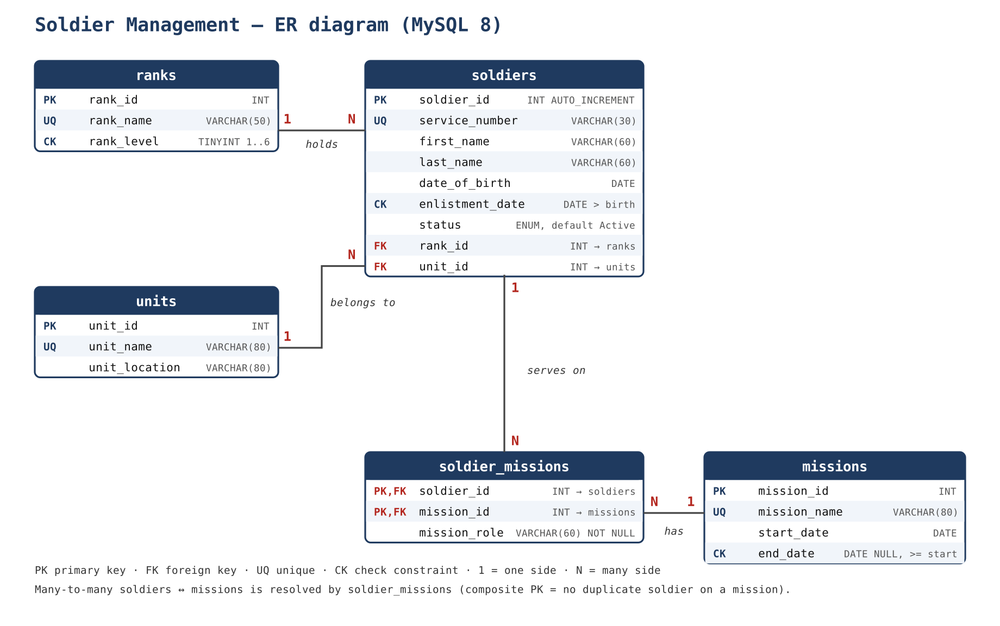
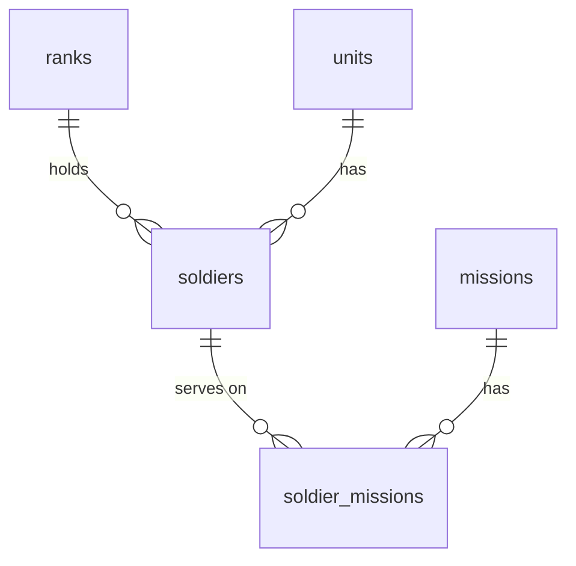

# Soldier Management SQL Quiz — MySQL 8

**Course:** SQL Database — Assignment V · **Institution:** ULK, Kigali · **Instructor:** Eric Maniraguha  
**Tool:** MySQL 8 · **Data:** all data is fictional.

## Students

| Student | Student number | Database | P | U | M |
|---|---|---|---|---|---|
| DAUGLA DOURAH | 202612707 | `sms_202612707` | 7 | 2 | 3 |
| ANAS | 202512831 | `sms_202512831` | 1 | 2 | 2 |
| ATEM GABRIEL BOL | 202511479 | `sms_202511479` | 9 | 2 | 5 |

Personal values (from the paper): `P` = last digit; `U` = (last two digits mod 6) + 1; `M` = ((P + 5) mod 5) + 1.
Soldier 32 rank = ((P + 6) mod 6) + 1 · Soldier 33 unit = ((U + 6) mod 6) + 1.

## Folder content

```
Soldier_Management_Three_Students/
├── README.md                  <- this file
├── sql/
│   └── Soldier_Management_Three_Students_MySQL8.sql   <- the 3 students in one file
├── students/
│   ├── sms_202612707.sql      <- one file per student (as asked in the paper)
│   ├── sms_202512831.sql
│   └── sms_202511479.sql
├── er-diagram/
│   ├── er_diagram.png         <- ER diagram (image)
│   ├── er_diagram.svg         <- ER diagram (vector)
│   └── er_diagram.mmd         <- ER diagram (Mermaid source)
└── docs/
    └── DESIGN_NOTES.md        <- tables, constraints and query explanations
```

## ER diagram





## How to run

Put `soldiers_seed.sql` (from the teacher) in the same folder, then:

```bash
mysql -u <exam_account> -p < students/sms_202612707.sql
```

Each file drops and recreates its own database `sms_<student number>`, creates the 5 tables (Part A),
inserts the data (Part B, including `SOURCE soldiers_seed.sql;`), then runs Parts C and D.

## Notes

- Every statement has a comment (`-- Does:` and `-- Rows returned:`), as required by the paper.
- `soldiers_seed.sql` belongs to the teacher and is not included, so row counts that depend on it are marked `<TO_FILL>`.
- The Change Order is given during the exam; its section is at the end of each file.
